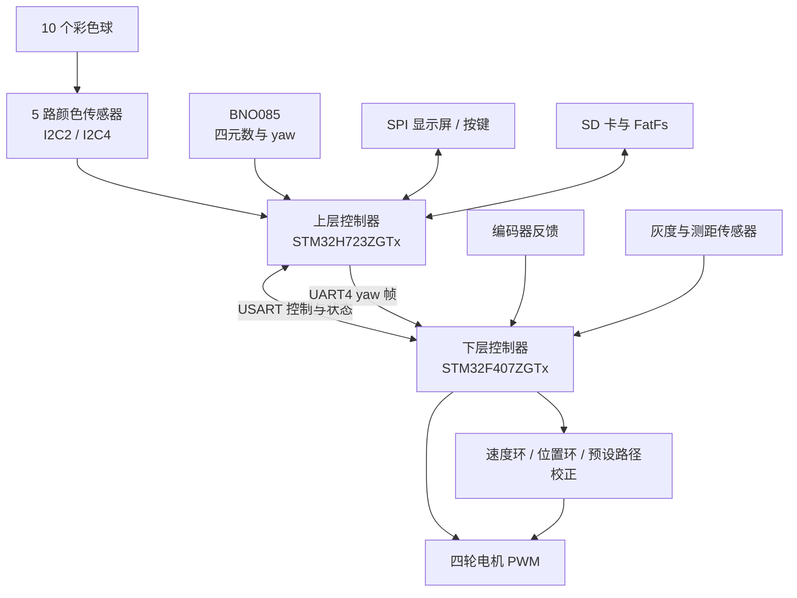

# 智能物流分拣小车


面向智能物流分拣与配送场景的双控制器机器人原型，覆盖颜色识别、物料队列管理、轮式底盘运动控制、测距校正、人机界面、PCB 与机械结构。

本项目使用 STM32H723 作为上层控制与交互单元、STM32F407 作为底盘实时控制单元，通过串口完成状态与运动指令协同。仓库包含两套控制器固件、两套 EDA 工程和 SolidWorks 机械模型，可作为嵌入式控制、机电一体化或机器人竞赛项目的复现基础。

## 功能概览

- **五色分类**：采集白、红、黄、绿、蓝五类 RGB 数据，采用最近邻距离完成初判，并在 10 个球的位置约束下保证每种颜色分配到 2 个样本。
- **物料队列管理**：维护左右投放口与 10 个球位，根据目标颜色计算最短转盘移动方向。
- **双控制器协同**：上层负责颜色、界面和流程调度，下层负责电机、编码器、底盘运动与传感器闭环。
- **姿态反馈**：读取 BNO085 四元数并解算 yaw，将角度编码后通过 UART 发送给下层。
- **运动控制**：四轮底盘采用 PWM 驱动与编码器反馈，代码中包含速度环和位置环增量式 PID。
- **离散位置校正**：使用前、后、左、右四路数字灰度传感器，并结合前、左、右测距信息在预设路径上完成方向和位置修正。
- **数据与交互**：上层提供 SPI 显示屏、SD 卡 FatFs 存储和串口交互，可将 10 个球的 RGB 分类结果写入 `data/RGB_Ball.csv`。

## 系统架构



## 目录说明

```text
Robocup/
├── README.md
├── Stm32H723_LTS_BSP_Tran/                       # 上层控制固件
├── Stm32F407_Motor_Controller/                   # 下层控制固件（Keil）
├── ProPrj_STM32H723、_2026-06-01.epro             # 上层控制板 EDA 工程
├── ProPrj_国赛底层板子_2026-05-31.epro             # 下层板与电源板 EDA 工程
├── 彩色智能投送模型.zip                           # 分件 SolidWorks 模型
└── 智能投送模型.zip                               # 整车 SolidWorks 装配模型
```

### 上层控制程序

目录：[Stm32H723_LTS_BSP_Tran](./Stm32H723_LTS_BSP_Tran/)

- 主程序：[Core/Src/main.c](./Stm32H723_LTS_BSP_Tran/Stm32H723_LTS_BSP_Tran/Core/Src/main.c)
- 颜色识别与队列：[YzOS/YzApplication/Src/ColorBall.c](./Stm32H723_LTS_BSP_Tran/Stm32H723_LTS_BSP_Tran/YzOS/YzApplication/Src/ColorBall.c)
- 交互与流程控制：[YzOS/YzApplication/Src/user_cxx.cpp](./Stm32H723_LTS_BSP_Tran/Stm32H723_LTS_BSP_Tran/YzOS/YzApplication/Src/user_cxx.cpp)
- CubeMX 工程：[Stm32H723_LTS_BSP.ioc](./Stm32H723_LTS_BSP_Tran/Stm32H723_LTS_BSP_Tran/Stm32H723_LTS_BSP.ioc)

### 下层控制程序

目录：[Stm32F407_Motor_Controller](./Stm32F407_Motor_Controller/)

- Keil 工程：[ZZWXC.uvprojx](./Stm32F407_Motor_Controller/RobotCupDownCore/USER/ZZWXC.uvprojx)
- 主流程与 PID 配置：[USER/main.c](./Stm32F407_Motor_Controller/RobotCupDownCore/USER/main.c)
- 底盘运动学与闭环：[Blance/balance.c](./Stm32F407_Motor_Controller/RobotCupDownCore/Blance/balance.c)
- 四路数字灰度：[USER/huidu.h](./Stm32F407_Motor_Controller/RobotCupDownCore/USER/huidu.h)
- 测距驱动：[HARDWARE/tof/tof.c](./Stm32F407_Motor_Controller/RobotCupDownCore/HARDWARE/tof/tof.c)

### 硬件与结构文件

- [上层控制板 EDA](<./ProPrj_STM32H723、_2026-06-01.epro>)
- [下层板与电源板 EDA](<./ProPrj_国赛底层板子_2026-05-31.epro>)
- [彩色智能投送模型.zip](./彩色智能投送模型.zip)
- [智能投送模型.zip](./智能投送模型.zip)

## 硬件与软件组成

| 模块 | 当前工程配置 |
| --- | --- |
| 上层主控 | STM32H723ZGTx，ARM Cortex-M7 |
| 下层主控 | STM32F407ZGTx，ARM Cortex-M4F；工程配置已确认，实物料号仍应结合板卡丝印复核 |
| 上层运行环境 | YzOS、MiniUI，仓库同时包含 LVGL、FatFs 等组件源码 |
| 下层运行环境 | STM32F4 标准外设库；工程树包含 FreeRTOS，但当前 `main()` 为直接初始化加预设路径控制 |
| 颜色检测 | 5 路 TCS34727 兼容传感器，分布于 I2C2 与 I2C4 |
| 姿态检测 | BNO085，I2C1 读取四元数，yaw 由上层解算 |
| 显示与存储 | SPI 显示屏、SDMMC1 + FatFs |
| 底盘控制 | 4 路电机 PWM、4 路编码器反馈、速度环与位置环 |
| 辅助定位 | 前、后、左、右数字灰度输入；前、左、右激光测距串口；`tof.c` 另提供 4 组软件 I²C 测距接口 |
| 主机通信 | 上层 USART1 控制与确认，UART4 发送 yaw 帧 |

## 关键实现

### 颜色分类

`ColorBall.c` 将每个球在 RGB 空间中的位置与白、红、黄、绿、蓝五个参考颜色比较，按欧氏距离的平方排序。程序先为每个球分配距离最近的颜色，再对数量超过 2 的颜色执行重分配，最终得到 10 个球、每色 2 个的分类结果。

五个颜色传感器通过跳线地址区分球位，上层同时维护左右投放口位置。需要移动转盘时，程序按目标球与当前索引的正负方向选择转动方向，并以定时器脉冲计数完成角度移动。

### 姿态通信

上层从 BNO085 读取 `x/y/z/w` 四元数并转换为 yaw，再以 8 字节 UART 帧周期发送给下层。角度按 `yaw / π × 32768` 量化，帧中最后两个字节以小端格式保存；该链路用于底盘航向反馈与校正。

### 底盘闭环

下层工程包含四轮运动学分配、编码器速度计算和 PWM 输出。 `main.c` 中当前配置为：

- 速度环：`Kp = 16`、`Ki = 4`、`Kd = 0`
- 位置环：`Kp = 8`、`Ki = 1.35`、`Kd = 5`

这些是代码中的控制参数。实际响应速度、超调量、航向误差和重复定位精度需要通过台架与场地实验验证。

### 路径校正

小车使用预设路径和离散点位完成场地配送任务。前、后、左、右灰度传感器用于检测边界或停止标记，前、左、右测距数据用于靠近目标位置时的方向修正。当前方案不包含 SLAM 或全局绝对定位。

## 运行流程

1. 上电后初始化上层外设、显示界面、SD 卡、5 路颜色传感器和 BNO085。
2. 将 10 个球放入转盘并旋转，使 5 个颜色传感器覆盖全部球位。
3. 完成 RGB 采样与数量约束分类，将结果写入显示界面和 SD 卡。
4. 上层根据目标投放口选择转盘方向，通过串口与下层完成启动和状态同步。
5. 下层读取编码器、灰度和测距数据，按预设路径与 PID 输出完成移动、校正和停靠。
6. 到达投放位后完成对应颜色球的释放，并返回下一工作状态。

## 构建与烧录

### 环境要求

| 用途 | 工具 |
| --- | --- |
| 上层交叉编译 | Arm GNU Toolchain（`arm-none-eabi-gcc`、`g++`、`objcopy`、`size`） |
| 上层构建 | GNU Make；当前 Makefile 中 `SHELL = powershell` |
| 下层构建 | Keil MDK / µVision，STM32F4 器件支持包 |
| 烧录调试 | 与目标板匹配的 ST-Link、DAP-Link 或板载调试器 |

### 编译上层固件

将 Arm GNU Toolchain 的 `bin` 目录加入 `PATH`，或通过 `GCC_PATH` 指定工具链：

```powershell
cd "Stm32H723_LTS_BSP_Tran/Stm32H723_LTS_BSP_Tran"
make -j4
```

工具链未加入 `PATH` 时：

```powershell
make -j4 GCC_PATH="C:/path/to/arm-none-eabi/bin"
```

构建产物位于 `build/`：

```text
Stm32H723_LTS_BSP.elf
Stm32H723_LTS_BSP.hex
Stm32H723_LTS_BSP.bin
```

### 编译下层固件

1. 使用 Keil MDK 打开 [ZZWXC.uvprojx](./Stm32F407_Motor_Controller/RobotCupDownCore/USER/ZZWXC.uvprojx)。
2. 选择目标 `ZZW`，确认器件为 `STM32F407ZGTx`。
3. 执行 **Build**，生成 `USER/Objects/ZZWXC.hex`。
4. 连接调试器，分别烧录上层和下层固件。

仓库中保留的已有构建产物日期分别为 2025-10-07（上层）和 2025-10-18（下层）。重新编译前应以当前源码和实物配置为准。

## 性能目标与验证状态

下表中的数值来自开题与答辩材料，属于设计或汇报目标。当前仓库没有完整保存对应测试条件、样本量、原始数据和误差统计，因此不能把这些数值视为已完成的验收结果。

| 指标 | 目标值 | 状态 |
| --- | --- | --- |
| 颜色识别率 | 99.5% | 待使用固定样本和固定光照条件复测 |
| 航向误差 | ±1° | 待使用场地轨迹记录验证 |
| 运行速度 | 0.15 / 0.3 m/s | 待分别测量直线与弯道条件 |
| 停靠误差 | ±10 mm | 待记录重复停靠结果 |
| 单次投放时间 | 2–3 s | 待记录完整动作时长 |
| 续航 | ≥5 h | 待记录电池规格、载荷与工况 |

## 已知限制与发布前检查

- 颜色传感器、测距模块、灰度有效电平和电池参数应以最新 EDA、驱动代码和实物为准。源码存在多种历史接口，不能只依据模块名称确定最终 BOM。
- 上层 EDA 的物料标注与 BNO085 设计选型可能需要进一步核对，最终应确认实际贴装器件。
- 论文和答辩材料中的性能数值缺少完整原始测试记录，公开发布前应补充测试方法与实测数据，或继续标注为预期指标。
- `build/`、`USER/Objects/` 和 `USER/Listings/` 中存在编译产物。建立公开仓库时可按发布策略保留可直接烧录的固件，或通过 `.gitignore` 排除中间文件。
- 当前版本对应毕业设计阶段的源码快照；后续完成指标验收后，可为可复现版本建立正式标签。

## 后续改进

- 增加颜色识别、航向、停靠和投放耗时的自动化测试与 CSV 记录。
- 将串口控制协议整理为带长度、序号和校验字段的文档化帧格式。
- 为上层提供统一的 `make` 与 CI 构建，为下层补充可替代 Keil 的项目配置。
- 补充 BOM、接线表、关键参数校准说明和实物照片。
- 将论文、答辩材料和测试报告整理为独立文档目录。

## 第三方组件与许可

工程包含 STM32 HAL/CMSIS、FreeRTOS、FatFs、LVGL、YzOS 和传感器驱动等第三方或派生组件，各组件遵循其原有许可。项目自身尚未添加统一的 `LICENSE` 文件；在公开发布或允许他人复用前，应根据原创代码、学校要求和第三方许可范围确定授权方式。

---

项目名称：**智能物流分拣小车设计**  
项目类型：**电子信息工程毕业设计 / 智能配送机器人原型**
